# TamaPoke: manual do jogador

*[English version](README.md)*

O TamaPoke é um bichinho virtual de Pokémon numa Poké Ball com tela redonda. Você
cria um Pokémon de verdade: dá comida, banho e hora de dormir, treina, batalha,
captura outros, enfrenta ginásios e viaja por nove regiões.

As telas deste manual saem do simulador do próprio jogo, então são iguais às da
placa.

<p align="center">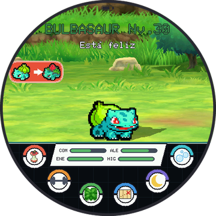</p>

## Sumário

0. [Instalar](#0-instalar)
1. [Começando](#1-começando)
2. [A tela inicial](#2-a-tela-inicial)
3. [Cuidados](#3-cuidados)
4. [Treino](#4-treino)
5. [Batalhas](#5-batalhas)
6. [Ginásios, regiões e revanche](#6-ginásios-regiões-e-revanche)
7. [A ficha](#7-a-ficha)
8. [Pokédex e caçada](#8-pokédex-e-caçada)
9. [Aventura](#9-aventura)
10. [Quiz do Professor](#10-quiz-do-professor)
11. [Conectar duas placas: troca e batalha](#11-conectar-duas-placas-troca-e-batalha)
12. [Evolução, despedida, fuga e soltar](#12-evolução-despedida-fuga-e-soltar)
13. [Ajustes e energia](#13-ajustes-e-energia)
14. [Bugs e sugestões](#14-bugs-e-sugestões)
15. [Para quem mexe no código](#15-para-quem-mexe-no-código)

---

## 0. Instalar

Tudo sai da página **[Releases](https://github.com/foulusama37/TamaPoke/releases)** do repositório: cada versão tem os
arquivos prontos. Você precisa de um cartão microSD de 2 GB ou mais: o jogo ocupa 1,4 GB.

**1. O cartão SD.** Baixe `TamaPoke-sdcard-vX.YY.zip` e extraia **tudo na raiz**
do cartão: as pastas `mons`, `snd`, `av`... ficam direto no cartão, não dentro de
outra pasta. São os sprites, sons, cenários e animações, já no formato da tela.
O pacote **não** traz o save: pode extrair por cima de um cartão em uso, para
atualizar, que o seu jogo continua.

**2. O firmware.** Ligue a placa no PC pelo USB e abra o gravador da Espressif no
Chrome ou Edge: <https://espressif.github.io/esptool-js/>. Clique em *Connect*,
escolha a porta da placa e grave **um** destes arquivos:

| Arquivo | Endereço | Quando usar |
|---|---|---|
| `TamaPoke-vX.YY-instalacao-completa.bin` | `0x0` | primeira vez. **Apaga tudo**, inclusive o save |
| `TamaPoke-vX.YY-atualizacao.bin` | `0x10000` | placa que já tem o jogo. **Mantém o save** |

Se a placa não conectar, segure o botão **BOOT**, aperte e solte **RESET**, e
solte o BOOT: ela entra no modo de gravação.

---

## 1. Começando

Na primeira vez que liga, o jogo mostra a abertura e o Professor, e depois
pergunta se você é menino ou menina. A escolha muda o sprite do treinador.
Toque para passar cada página. Na última fala ele conta onde fica este manual.

<p align="center">
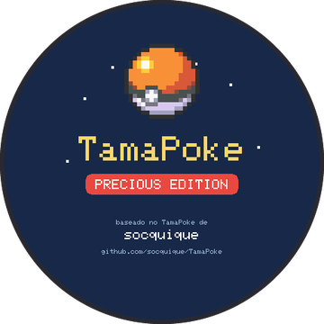
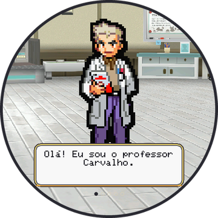
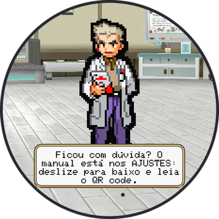
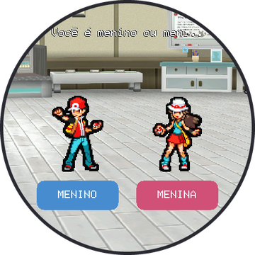
</p>

Depois você escolhe o **inicial** entre os três da região: em Kanto, Bulbasaur,
Charmander e Squirtle. Ele nasce de um **ovo**: toque no ovo 3 vezes para
chocar, ou espere 3 minutos.

O Professor também dá **5 Poké Balls** para começar.

## 2. A tela inicial

Em cima ficam o nome, o nível e o humor do Pokémon. No meio fica o cenário, que
muda com o tipo dele e com a hora (de noite, das 20h às 6h, entra o cenário
noturno). Embaixo ficam as quatro barras e os seis botões.

<p align="center"></p>

**As barras** vão de 0 a 100: **COM** (comida), **ALE** (alegria), **ENE**
(energia) e **HIG** (higiene). Quando uma fica abaixo de 35, aparece um balão
com o que ele precisa.

**Os seis botões**, da esquerda para a direita:

| Botão | O que faz |
|---|---|
| 🍓 Comida | Abre as bagas (veja [Cuidados](#3-cuidados)) |
| 🥊 Treinar | O minijogo do saco de pancadas ([Treino](#4-treino)) |
| 🌿 Mato | Procura um Pokémon selvagem para batalhar |
| 🎒 Aventura | Manda o Pokémon passear ([Aventura](#9-aventura)) |
| 🌙 Luz | Apaga a luz para dormir, ou acorda |
| 🛁 Banho | Limpa as sujeiras e enche a higiene |

**Gestos na tela inicial:**

| Gesto | Abre |
|---|---|
| Deslizar para cima | [A ficha](#7-a-ficha) |
| Deslizar para baixo | [Ajustes e relógio](#13-ajustes-e-energia) |
| Deslizar para a esquerda | [Pokédex](#8-pokédex-e-caçada) |
| Deslizar para a direita | [Mapa das regiões](#6-ginásios-regiões-e-revanche) |
| Tocar no Pokémon | Carinho: +5 alegria, +1 de laço |
| Segurar 3 s no Pokémon | Pergunta se quer soltá-lo |

**Visitas.** De vez em quando aparece alguém na tela. Toque para atender:

- **"!" (treinador)**: um treinador quer batalhar. Ele espera até 8 minutos.
- **Enfermeira**: passa a cada 7 minutos, mas só se alguém do time estiver
  ferido. Fica 2 minutos. Tocar cura o time todo.
- **Professor**: passa a cada 11 minutos e fica 3. Tocar abre o
  [Quiz](#10-quiz-do-professor).

<p align="center">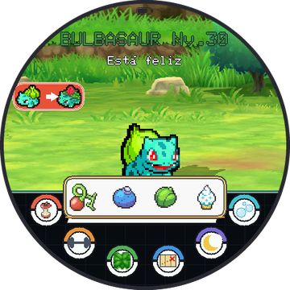</p>

## 3. Cuidados

As barras caem com o tempo (por minuto, acordado):

- **Comida** −2
- **Energia** −1 (−2 se ele estiver gordinho)
- **Higiene** −1, e cada sujeira a mais tira 4. Até 3 sujeiras.
- **Alegria** −1, e cai mais rápido com fome ou sujo.

**Comer.** O botão de comida abre 3 bagas e um doce:

- Baga: +25 de comida. Cura 15% dos PS e repõe os PP.
- A baga **favorita** dele: +35 de comida, +10 de alegria, +2 de laço, cura 30%.
  Descubra qual é testando.
- Doce (Casteliacone): +10 de comida e +12 de alegria, mas engorda.

**Dormir.** Dormindo, a energia sobe 6 por minuto, as outras barras caem bem
mais devagar e ele recupera PS e PP.

**Banho.** Tira todas as sujeiras, enche a higiene e dá +1 de laço.

**Descuido.** Qualquer barra chegando a 10 ou menos conta como um descuido e
tira 1 de laço (no máximo um por hora). Os descuidos não atrasam a evolução, mas
pioram o ovo que ele deixa na despedida.

**Sequência de dias.** O primeiro cuidado de cada dia conta. Ele dá:

- +4 de laço e +120 de EXP;
- uma Poké Ball;
- a cada 7 dias seguidos, uma Great Ball; a cada 30, uma Ultra Ball;
- comemorações em 3, 7, 30 e 100 dias.

**Laço.** Começa em 60 e sobe no máximo 20 por dia. Abaixo de 60, ele pode
**desobedecer** em batalha (até 1 vez em 5 turnos).

## 4. Treino

O botão de treinar abre o saco de pancadas. Escolha qual stat treinar e acerte a
fraqueza do tipo que aparece no saco, em 15 segundos.

<p align="center">
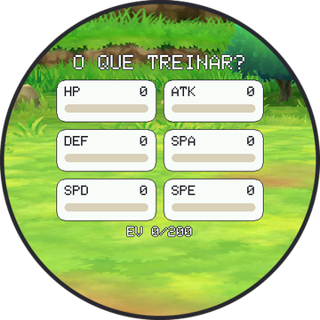
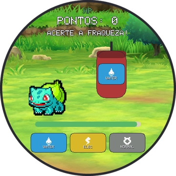
</p>

- Golpe **super eficaz**: +3 pontos (+1 a mais a cada 3 seguidos).
- Golpe **neutro**: +1 ponto.
- Golpe **resistido**: perde quase 1 segundo.

Cada 2 pontos viram 1 ponto de treino (EV) naquele stat, até 12 por sessão.
O teto é 100 por stat e 200 no total.

Precisa de 30 de energia e gasta 12. A cada 12 pontos você ganha uma Poké Ball
(no máximo 2 por sessão), e com pontuação alta saem Great e Ultra Balls.

## 5. Batalhas

Uma batalha começa pelo botão do **mato**, por um **"!"** de treinador, pelo
[ginásio](#6-ginásios-regiões-e-revanche) ou pela revanche.

Para batalhar, ele precisa estar acordado, com pelo menos 20 de energia e 25% dos
PS. Cada batalha gasta 8 de energia. O botão do mato espera 60 segundos entre
uma busca e outra.

<p align="center">
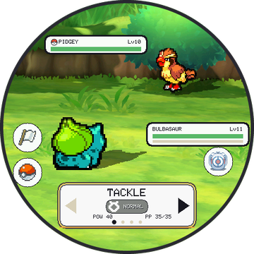
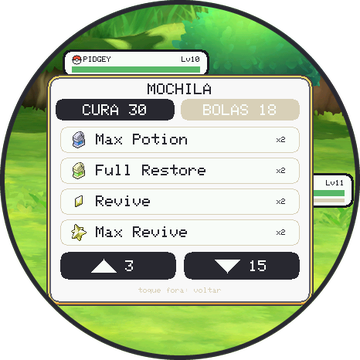
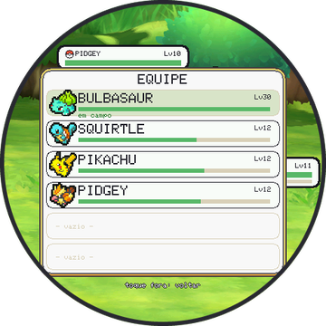
</p>

**Na tela de batalha:**

- **Cartão do golpe** (embaixo): as setas trocam o golpe, e tocar no cartão ataca.
- **Mochila** (direita): poções e Poké Balls.
- **Time** (esquerda, embaixo): troca o Pokémon que está lutando.
- **Fugir** (esquerda, no meio): só contra selvagens.
- **Mega** (esquerda, em cima): aparece se ele segura a Mega Stone dele. Uma vez
  por batalha.

**Capturar.** Jogue uma bola pela mochila. Enquanto a bola balança,
**toque na tela**: cada toque ajuda um pouco. A chance também sobe com o
selvagem fraco, dormindo ou congelado, e com bolas melhores. O capturado vai
para o time, ou para o banco se o time estiver cheio.

<p align="center">
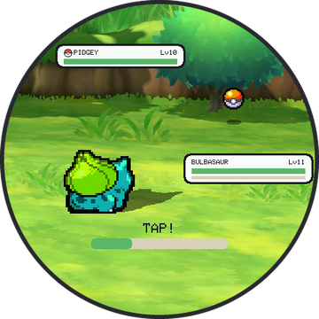
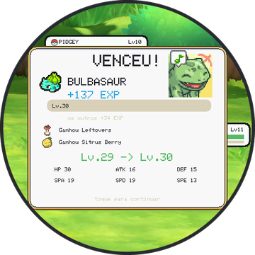
</p>

**Vitória.** Mostra a EXP ganha, a subida de nível e o que caiu. Os outros do time
também ganham um quarto da EXP.

**Selvagens:**

- aparecem com nível parecido com o seu;
- 1 em 128 é **shiny**;
- os da região atual aparecem mais, assim como os do mesmo ambiente que o seu
  Pokémon; fantasma e veneno aparecem mais à noite;
- 1 em cada 10 buscas espia a próxima região, ainda fechada;
- **lendários**: depois das 8 insígnias de uma região, cada busca tem 3% de
  chance de trazer um lendário dela ou de uma região anterior.

Os "!" automáticos são sempre treinadores, com 1 a 3 Pokémon.

**Não há loja.** As bolas vêm dos cuidados diários, do treino, dos prêmios de
líder e medalha, do que cai nas batalhas e da aventura.

## 6. Ginásios, regiões e revanche

Deslize para a **direita** na tela inicial para abrir o mapa. Na região onde você
está ficam os botões **Ginásios** e **Medalhas**.

<p align="center">
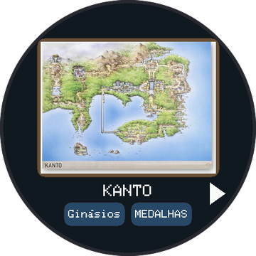
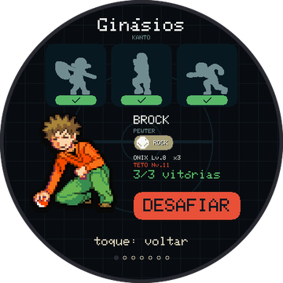
</p>

**O ginásio.** Cada líder tem **3 treinadores** na frente, que você vence em
ordem. Só então o botão **DESAFIAR** acende. Cada região tem **13 desafios**:
8 líderes (as insígnias), 4 da Elite e o Campeão.

Cada líder vencido dá a insígnia, uma **MT** do tipo dele (as MTs não acabam) e
uma pedra de evolução ou bolas.

<p align="center">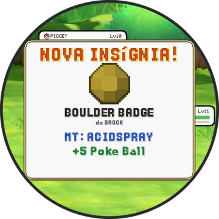</p>

**Teto de nível.** Acima do teto, o Pokémon luta no nível do teto. O teto é o
nível do ás do próximo desafio mais 3. Quando você termina uma região, o teto
some.

**Viajar.** Depois do Campeão, o mesmo botão leva à próxima região (Kanto, Johto,
Hoenn, Sinnoh, Unova, Kalos, Alola, Galar, Paldea). No mapa você vai e volta
quando quiser. Cada região guarda seu próprio time, titular e insígnias, e na
primeira visita você ganha o inicial de lá.

<p align="center">
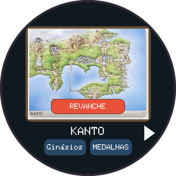
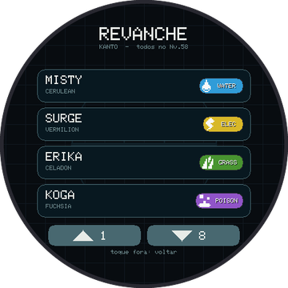
</p>

**Revanche.** Com a região terminada, o mapa mostra o botão **REVANCHE**: os 13
desafios de novo, todos no nível do Campeão, com Mega e prêmios melhores (mas sem
insígnia).

## 7. A ficha

Deslize para **cima** na tela inicial. Deslize para os lados para trocar de
página e toque no título para voltar.

<p align="center">
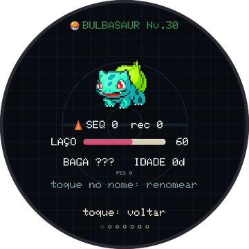
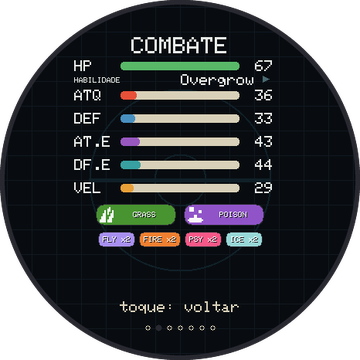
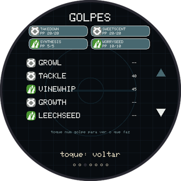
</p>

- **Perfil**: a bola em que veio, a sequência, o laço, a baga favorita, a idade.
  Toque no nome para dar um apelido.
- **Combate**: os stats, a habilidade (toque para ler o que ela faz) e as
  fraquezas.
- **Golpes**: os 4 golpes em uso em cima. Embaixo vêm os que ele conhece e as
  MTs que pode aprender (marcadas "MT"). Toque para equipar, ou para ler a
  descrição.

<p align="center">
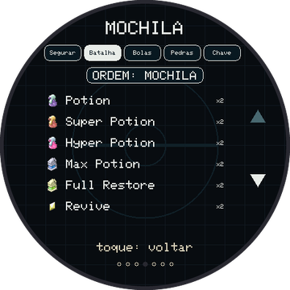
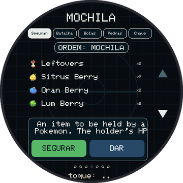
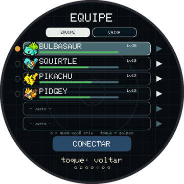
</p>

- **Mochila**: as abas são Segurar, Batalha, Bolas, Pedras e Chave, e o botão
  ORDEM muda a ordenação. Itens de batalha se usam direto. Um objeto para segurar
  abre a ficha dele, com **SEGURAR** e **DAR** (dar para outro do time). Pedras de
  evolução também se usam direto.
- **Equipe**: o círculo à esquerda faz daquele o titular. A seta à direita manda
  para o banco, e tocar na linha mostra os golpes. Embaixo fica o botão
  **CONECTAR** ([troca e batalha entre placas](#11-conectar-duas-placas-troca-e-batalha)).

<p align="center">
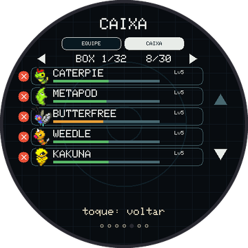
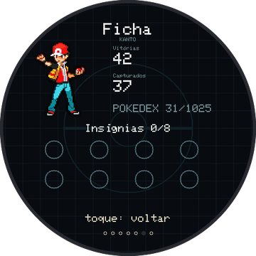
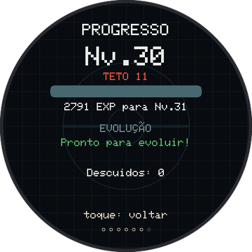
</p>

- **Caixa (banco)**: são 32 caixas de 30 Pokémon. Toque em um para trazê-lo ao
  time, e o X solta (com confirmação). Um cadeado marca quem está acima do nível
  que você pode usar na região.
- **Ficha de treinador**: vitórias, capturas, Pokédex e insígnias.
- **Progresso**: o nível, quanto falta para o próximo, o teto e a evolução
  (o nível em que evolui, ou a pedra de que precisa).

As **medalhas** (pelo botão do mapa) são 30 conquistas: níveis, sequência, laço,
Pokédex, capturas, vitórias, shiny, Mega, revanche e uma por região terminada.
Cada uma dá um prêmio.

<p align="center">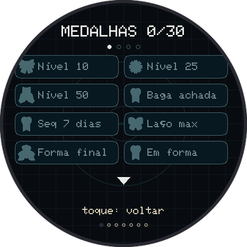</p>

## 8. Pokédex e caçada

Deslize para a **esquerda** na tela inicial. A Pokédex tem 1025 Pokémon, 16 por
página.

<p align="center">
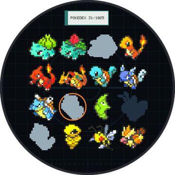
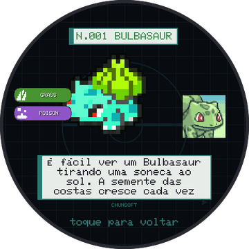
</p>

Cada Pokémon aparece de um de três jeitos:

- **Colorido**: registrado (você teve ele).
- **Cinza-azulado**: **visto**. Você batalhou contra ele, ou ele apareceu na
  aventura.
- **Escuro**: nunca visto.

O registrado mostra o sprite, o choro, os tipos e o texto da Pokédex. A seta troca
entre normal, shiny, formas e Mega.

<p align="center">
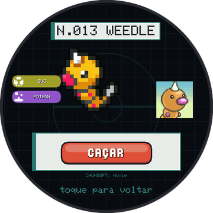
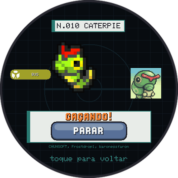
</p>

**Caçar.** Tocar num **visto** mostra o Pokémon e o botão **CAÇAR**. Enquanto você
caça:

- **1 em cada 4** buscas no mato traz ele, se ele aparece naquela região;
- lendário: **1 em cada 10**, e só depois das 8 insígnias;
- só uma espécie por vez: caçar outra troca a caçada;
- a caçada acaba quando você captura o Pokémon;
- não muda a aventura, só o mato;
- na grade, o caçado ganha um anel laranja.

Um visto que não aparece no mato daquela região mostra "Não aparece no mato aqui".

## 9. Aventura

O botão da mochila manda o titular **passear**. A tela mostra o passeio: ele anda,
brinca, encontra outros Pokémon, luta, acha itens e cochila. Enquanto ele está
fora, as barras não caem.

<p align="center">
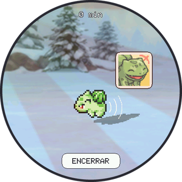
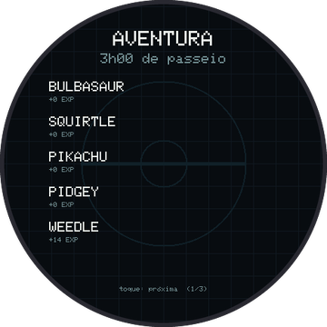
</p>

Toque **ENCERRAR** para ver o resumo. O relógio conta mesmo com a placa
desligada:

- vale até **8 horas**, e depois de 2 horas o tempo conta pela metade;
- **EXP**: o titular ganha cerca de 1/4 de nível por hora, o resto do time ganha
  metade disso, e até 6 do banco ganham um quarto (sempre respeitando o teto);
- **itens**: a cada 40 minutos há um sorteio (no máximo 8): remédios, objetos,
  bolas, pedras e, raramente, uma Mega Stone.

## 10. Quiz do Professor

Quando o Professor aparece na tela inicial, toque nele. São 5 perguntas: tipo do
Pokémon, em quem ele evolui, tipo do golpe, o mais pesado, qual golpe ele aprende,
e "Quem é esse Pokémon?".

<p align="center">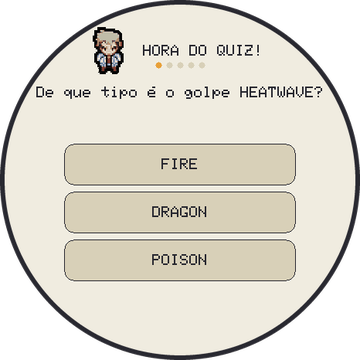</p>

**Prêmios:**

| Acertos | Prêmio |
|---|---|
| 2 | Super Potion |
| 3 | Hyper Potion |
| 4 | Max Potion |
| 5 | 2 Rare Candy, ou (1 em 20) a **Poção Shiny**, que deixa o titular shiny |

## 11. Conectar duas placas: troca e batalha

Na página **Equipe** da ficha, toque **CONECTAR**. A outra placa precisa estar
perto e com a mesma tela aberta. Toque nela e escolha **TROCAR** ou
**BATALHAR**.

<p align="center">
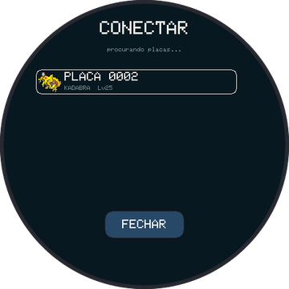
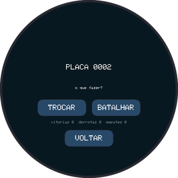
</p>

**Troca.** Cada um escolhe um Pokémon do time ou da caixa, e os dois confirmam.
- O objeto que ele segura vai junto.
- Quem evolui por troca evolui ao chegar.
- Quem chega acima do teto vai para a caixa.
- O recebido entra na sua Pokédex.

<p align="center">
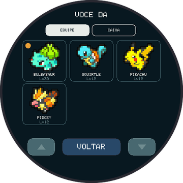
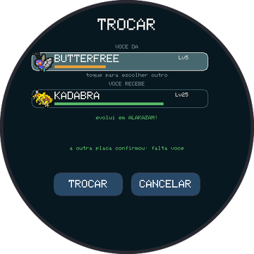
</p>

**Batalha.** Quem convida escolhe as regras: 1 contra 1, 3 contra 3 ou 6 contra 6,
e itens (nenhum, até 3, ou livres). Todos lutam no **nível 50** e ninguém
desobedece. Cada escolha tem 60 segundos, e a bandeira desiste (tocando 2 vezes).
**O save não muda**: só o placar de vitórias, derrotas e empates.

<p align="center">
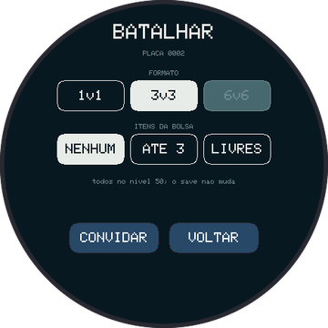
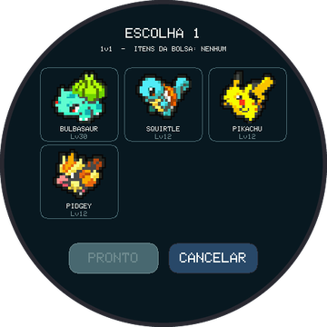
</p>

## 12. Evolução, despedida, fuga e soltar

Nenhum desses acontece sozinho: o jogo sempre pergunta, e você assiste.

<p align="center">
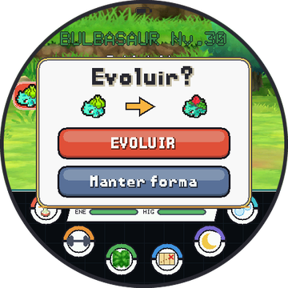
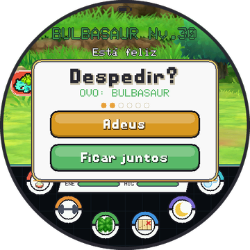
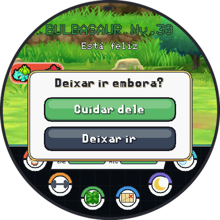
</p>

- **Evolução**: ao chegar no nível, aparece o botão vermelho. **EVOLUIR** ou
  **Manter forma**. Quem evolui por pedra usa a pedra pela mochila. Segurando uma
  Everstone, ele não evolui. Quem está no time também pode evoluir: aparece um
  botão verde.
- **Despedida**: na forma final, com pelo menos 3 dias de idade, 1 dia na forma
  final e laço 70 ou mais, ele pode se despedir. Deixa um **ovo** da mesma
  espécie, com genes melhores, mais chance de shiny e um golpe dele. Se você
  disser não, ele pergunta de novo no dia seguinte.
- **Fuga**: com as 4 barras zeradas por 1 hora, ele foge. Antes disso, chora a
  cada 15 minutos, e um único cuidado cancela. Quem foge deixa o próximo ovo
  mais fraco.
- **Soltar**: segure 3 s no Pokémon.

<p align="center">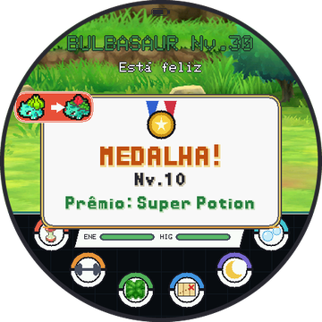</p>

## 13. Ajustes e energia

Deslize para **baixo** na tela inicial. Ali ficam a hora e os minutos, o volume
(0 a 3), a **língua** (ES, EN, FR, DE, IT, PT, JA, KO) e **APAGAR TUDO** (pede
duas confirmações). Toque **OK** para aplicar, ou deslize para cancelar.

No topo fica o botão **MANUAL**: ele mostra um QR code. Aponte a câmera do
celular e abre este manual (em português o LEIAME, nas outras línguas o README
em inglês). Qualquer toque fecha o QR e volta aos ajustes.

<p align="center">
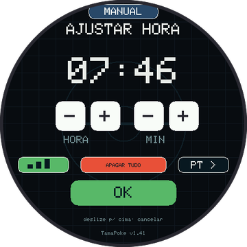
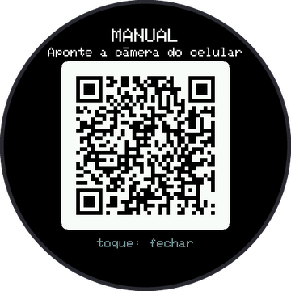
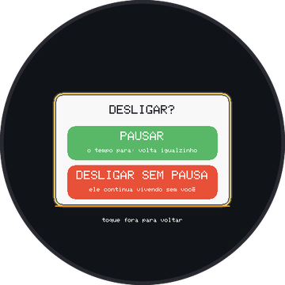
</p>

**O botão de ligar:**

- **Toque curto**: apaga ou acende a tela.
- **Segurar**: pergunta como desligar.
  - **PAUSAR**: o tempo para, e ele volta igualzinho.
  - **DESLIGAR SEM PAUSA**: o relógio continua, e ele segue vivendo (e sentindo
    fome) sem você.

A tela escurece sozinha: depois de 90 segundos parado e de novo depois de 5
minutos.

---

## 14. Bugs e sugestões

Achou um defeito ou tem uma ideia? Conte por um destes caminhos:

- **GitHub:** abra uma *issue* em <https://github.com/foulusama37/TamaPoke/issues>.
- **Discord:** canal **#sugestões-e-bugs** do servidor Foulu Games, <https://discord.gg/ueU3a4pSXz>.
  Dúvidas de montagem e gravação vão no **#tamapoke-ajuda**.

Para a gente achar o problema rápido, mande:

1. a **versão** do firmware (Ajustes, deslizando para baixo na tela inicial);
2. **o que você fez** antes de dar errado, passo a passo;
3. **o que aconteceu** e **o que você esperava**;
4. uma **foto ou vídeo da tela**, se der.

Sem o save, ninguém mexe na sua placa: as correções saem num Release novo.

## 15. Para quem mexe no código

**Refazer as fotos deste manual** depois de mudar o jogo (de `test/`, com a
toolchain no PATH):

```sh
mingw32-make uibin
TAMA_MANUAL=pt ./build/tamapoke_uitests manual
TAMA_MANUAL=en ./build/tamapoke_uitests manual
cd .. && python tools/manual_fotos.py
```

O teste `manual` está no fim de `test/test_ui.cpp`. Ele monta um jogo de exemplo
e grava cada tela em `_claude_scratch/prev_man_<língua>_<tela>.ppm`.
`tools/manual_fotos.py` recorta as fotos em círculo e as põe em `docs/manual/img/`.

**Publicar uma versão** (o cartão vai no Release, não no git):

```sh
python tools/pack_sdcard_zip.py      # -> dist/TamaPoke-sdcard-vX.YY.zip (conferido)
```

Depois anexe o zip e os dois `.bin` (`build/.../TamaPoke.ino.merged.bin` como
`instalacao-completa`, `TamaPoke.ino.bin` como `atualizacao`) num Release novo.
