# TamaPoke: player's manual

*[Versão em português](LEIAME.md)*

TamaPoke is a Pokémon virtual pet inside a Poké Ball with a round screen. You
raise a real Pokémon: feed it, bathe it and put it to bed, train it, battle,
catch others, take on gyms and travel across nine regions.

The screens in this manual come from the game's own simulator, so they match
the board.

<p align="center">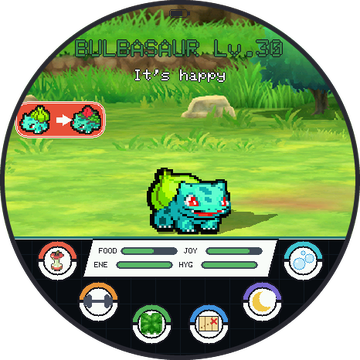</p>

## Contents

0. [Installing](#0-installing)
1. [Getting started](#1-getting-started)
2. [The home screen](#2-the-home-screen)
3. [Care](#3-care)
4. [Training](#4-training)
5. [Battles](#5-battles)
6. [Gyms, regions and rematch](#6-gyms-regions-and-rematch)
7. [The card](#7-the-card)
8. [Pokédex and hunting](#8-pokédex-and-hunting)
9. [Adventure](#9-adventure)
10. [Professor's quiz](#10-professors-quiz)
11. [Connecting two boards: trade and battle](#11-connecting-two-boards-trade-and-battle)
12. [Evolution, farewell, running away and release](#12-evolution-farewell-running-away-and-release)
13. [Settings and power](#13-settings-and-power)
14. [Bugs and suggestions](#14-bugs-and-suggestions)
15. [For developers](#15-for-developers)

---

## 0. Installing

Everything comes from the repository's **[Releases](https://github.com/foulusama37/TamaPoke/releases)** page: each version
has the files ready. You need a microSD card (any card of 1 GB or more).

**1. The SD card.** Download `TamaPoke-sdcard-vX.YY.zip` and extract **everything
to the root** of the card: the `mons`, `snd`, `av`... folders sit directly on the
card, not inside another folder. These are the sprites, sounds, backgrounds and
animations, already in the screen's format. The package does **not** include
the save: you can extract it over a card in use to update, and your game stays.

**2. The firmware.** Plug the board into the PC over USB and open Espressif's
flasher in Chrome or Edge: <https://espressif.github.io/esptool-js/>. Click
*Connect*, pick the board's port and flash **one** of these files:

| File | Address | When |
|---|---|---|
| `TamaPoke-vX.YY-instalacao-completa.bin` | `0x0` | first time. **Erases everything**, save included |
| `TamaPoke-vX.YY-atualizacao.bin` | `0x10000` | a board that already has the game. **Keeps the save** |

If the board does not connect, hold **BOOT**, press and release **RESET**, then
release BOOT: it enters flashing mode.

---

## 1. Getting started

The first time it powers on, the game shows the title and the Professor, then
asks whether you are a boy or a girl. This choice changes the trainer sprite.
Tap to turn each page. His last line tells you where this manual is.

<p align="center">
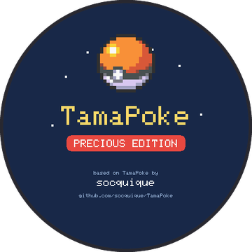
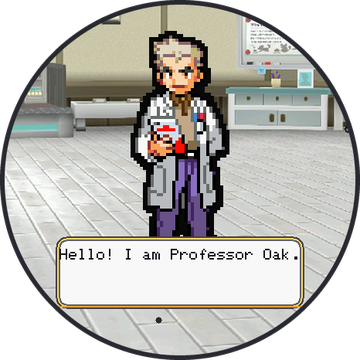
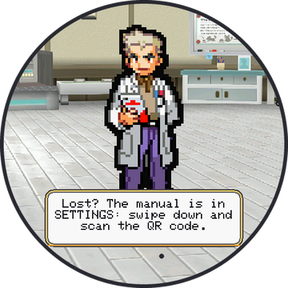
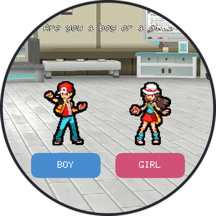
</p>

Next you pick your **starter** from the region's three. In Kanto they are
Bulbasaur, Charmander and Squirtle. It hatches from an **egg**: tap the egg 3
times, or wait 3 minutes.

The Professor also gives you **5 Poké Balls** to start with.

## 2. The home screen

At the top are the Pokémon's name, level and mood. In the middle is the scene,
which changes with its type and the time of day: from 8 pm to 6 am the night
scene appears. At the bottom are the four bars and the six buttons.

<p align="center"></p>

**The bars** run from 0 to 100: **FOOD**, **JOY**, **ENE** (energy) and **HYG**
(hygiene). When one drops below 35, a bubble shows what it needs.

**The six buttons**, left to right:

| Button | What it does |
|---|---|
| 🍓 Food | Opens the berries (see [Care](#3-care)) |
| 🥊 Train | The punching-bag minigame ([Training](#4-training)) |
| 🌿 Grass | Looks for a wild Pokémon to battle |
| 🎒 Adventure | Sends your Pokémon out on a trip ([Adventure](#9-adventure)) |
| 🌙 Light | Turns the light off to sleep, or wakes it up |
| 🛁 Bath | Cleans up the mess and fills hygiene |

**Gestures on the home screen:**

| Gesture | Opens |
|---|---|
| Swipe up | [The card](#7-the-card) |
| Swipe down | [Settings and clock](#13-settings-and-power) |
| Swipe left | [Pokédex](#8-pokédex-and-hunting) |
| Swipe right | [Region map](#6-gyms-regions-and-rematch) |
| Tap the Pokémon | Pet it: +5 joy, +1 bond |
| Hold the Pokémon for 3 s | Asks whether to release it |

**Visitors.** Now and then someone shows up on screen. Tap them:

- **"!" (trainer)**: a trainer wants to battle. They wait up to 8 minutes.
- **Nurse**: comes every 7 minutes, but only if someone on the team is hurt.
  She stays 2 minutes. Tapping her heals the whole team.
- **Professor**: comes every 11 minutes and stays 3. Tapping him opens the
  [quiz](#10-professors-quiz).

<p align="center">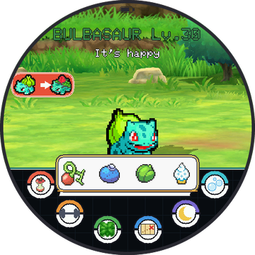</p>

## 3. Care

The bars drop over time (per minute, while awake):

- **Food** −2
- **Energy** −1 (−2 if it is chubby)
- **Hygiene** −1, and each mess takes 4 more. Up to 3 messes.
- **Joy** −1, and it drops faster when hungry or dirty.

**Eating.** The food button opens 3 berries and a treat:

- Berry: +25 food. Heals 15% HP and restores PP.
- Its **favourite** berry: +35 food, +10 joy, +2 bond, heals 30%. Try them to
  find out which one it is.
- Treat (Casteliacone): +10 food and +12 joy, but it is fattening.

**Sleep.** While asleep, energy rises by 6 per minute, the other bars drop much
more slowly, and HP and PP recover.

**Bath.** Removes all the mess, fills hygiene and gives +1 bond.

**Slip-ups.** Any bar reaching 10 or less counts as a slip-up and costs 1 bond
(at most one per hour). Slip-ups do not delay evolution, but they make the egg it
leaves at farewell weaker.

**Daily streak.** The first care action each day counts. It gives:

- +4 bond and +120 EXP;
- a Poké Ball;
- a Great Ball every 7 days in a row, and an Ultra Ball every 30;
- celebrations at 3, 7, 30 and 100 days.

**Bond.** Starts at 60 and rises by at most 20 a day. Below 60, it may
**disobey** in battle (up to 1 turn in 5).

## 4. Training

The train button opens the punching bag. Pick a stat to train, then hit the
weakness of the type shown on the bag for 15 seconds.

<p align="center">
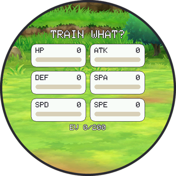
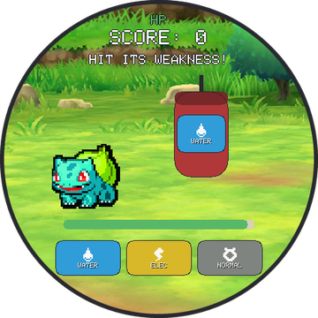
</p>

- **Super-effective** hit: +3 points (+1 more for every 3 in a row).
- **Neutral** hit: +1 point.
- **Resisted** hit: you lose almost 1 second.

Every 2 points become 1 training point (EV) in that stat, up to 12 per session.
The cap is 100 per stat and 200 in total.

It needs 30 energy and costs 12. Every 12 points earn a Poké Ball (at most 2 per
session), and high scores give Great and Ultra Balls.

## 5. Battles

A battle starts from the **grass** button, a trainer's **"!"**, the
[gym](#6-gyms-regions-and-rematch) or a rematch.

To battle, your Pokémon must be awake, with at least 20 energy and 25% HP. Each
battle costs 8 energy. The grass button waits 60 seconds between searches.

<p align="center">
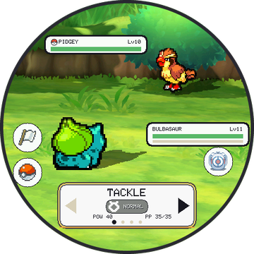
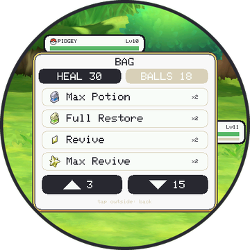
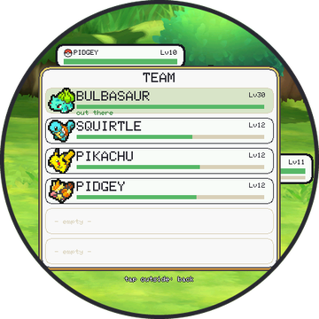
</p>

**On the battle screen:**

- **Move card** (bottom): the arrows change the move, and tapping the card attacks.
- **Bag** (right): potions and Poké Balls.
- **Team** (lower left): switches the Pokémon that is fighting.
- **Run** (middle left): wild battles only.
- **Mega** (upper left): appears when it holds its own Mega Stone. Once per
  battle.

**Catching.** Throw a ball from the bag. While the ball wobbles, **tap the
screen**: each tap helps a little. The odds also go up when the wild Pokémon is
weak, asleep or frozen, and with better balls. The catch joins your team, or the
bank if the team is full.

<p align="center">
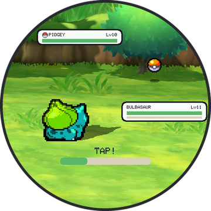
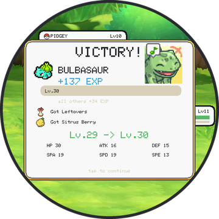
</p>

**Victory.** Shows the EXP earned, any level-up and the loot. The rest of the team
gets a quarter of the EXP too.

**Wild Pokémon:**

- appear at a level close to yours;
- 1 in 128 is **shiny**;
- ones from the current region appear more often, as do ones from your Pokémon's
  habitat; Ghost and Poison types appear more at night;
- 1 search in 10 peeks into the next region, which is still locked;
- **legendaries**: after a region's 8 badges, every search has a 3% chance of
  bringing a legendary from that region or an earlier one.

The automatic "!" is always a trainer, with 1 to 3 Pokémon.

**There is no shop.** Balls come from daily care, training, leader and medal
prizes, battle loot and the adventure.

## 6. Gyms, regions and rematch

Swipe **right** on the home screen to open the map. The region you are in has the
**Gyms** and **Medals** buttons.

<p align="center">
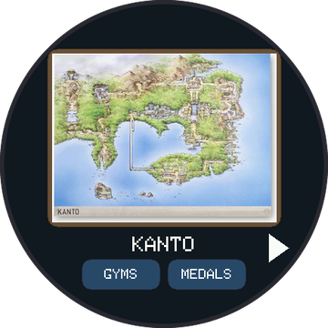
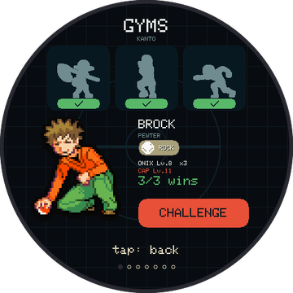
</p>

**The gym.** Every leader has **3 trainers** in front, which you beat in order.
Only then does the **CHALLENGE** button light up. Each region has **13
challenges**: 8 leaders (the badges), the Elite Four and the Champion.

Each leader you beat gives the badge, a **TM** of their type (TMs never run out)
and an evolution stone or some balls.

<p align="center">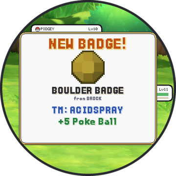</p>

**Level cap.** Above the cap, your Pokémon fights at the cap level. The cap is the
level of the next challenge's ace plus 3. Once you finish a region, the cap is
gone.

**Travelling.** After the Champion, the same button takes you to the next region
(Kanto, Johto, Hoenn, Sinnoh, Unova, Kalos, Alola, Galar, Paldea). On the map you
can travel back and forth freely. Each region keeps its own team, main Pokémon
and badges, and on your first visit you get that region's starter.

<p align="center">
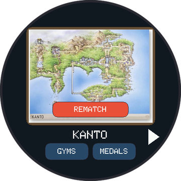
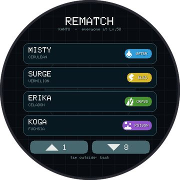
</p>

**Rematch.** Once a region is finished, the map shows **REMATCH**: the 13
challenges again, all at the Champion's level, with Megas and better prizes (but
no badges).

## 7. The card

Swipe **up** on the home screen. Swipe sideways to change pages, and tap the
title to go back.

<p align="center">
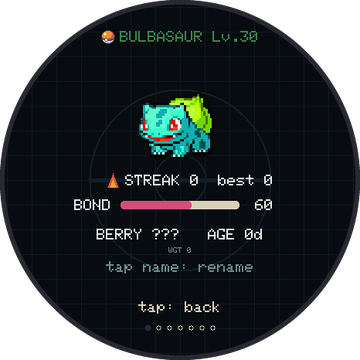
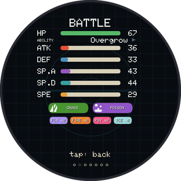
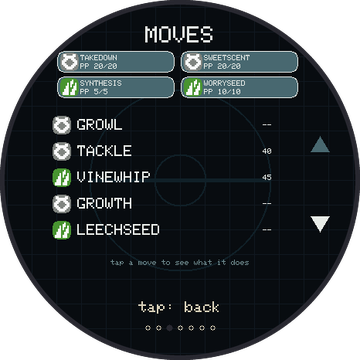
</p>

- **Profile**: the ball it came in, the streak, bond, favourite berry and age.
  Tap the name to give it a nickname.
- **Battle**: stats, ability (tap it to read what it does) and weaknesses.
- **Moves**: the 4 moves in use are at the top. Below are the moves it knows and
  the TMs it can learn (marked "TM"). Tap to equip one, or to read its
  description.

<p align="center">
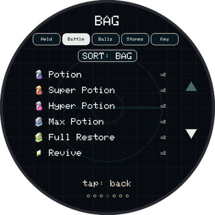
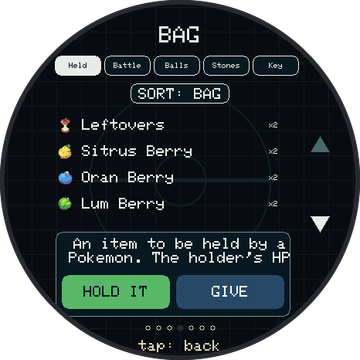
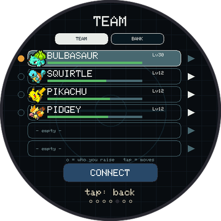
</p>

- **Bag**: the tabs are Held, Battle, Balls, Stones and Key, and the SORT button
  changes the order. Battle items are used directly. A held item opens its own
  page, with **HOLD IT** and **GIVE** (give it to someone else on the team).
  Evolution stones are used directly.
- **Team**: the circle on the left makes that one your main Pokémon. The arrow on
  the right sends it to the bank, and tapping the row shows its moves. At the
  bottom is the **CONNECT** button
  ([trade and battle between boards](#11-connecting-two-boards-trade-and-battle)).

<p align="center">
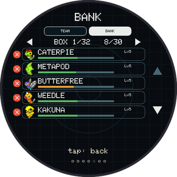
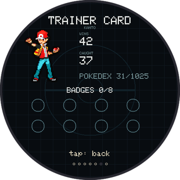
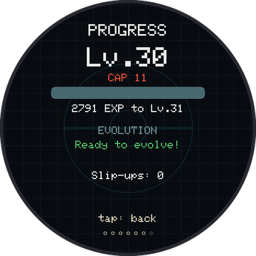
</p>

- **Box (bank)**: 32 boxes of 30 Pokémon. Tap one to bring it to the team, and X
  releases it (after a confirmation). A padlock marks anyone above the level you
  can use in this region.
- **Trainer card**: wins, catches, Pokédex and badges.
- **Progress**: the level, how far the next one is, the cap and evolution (the
  level it evolves at, or the stone it needs).

The **medals** (from the map button) are 30 achievements: levels, streak, bond,
Pokédex, catches, wins, shiny, Mega, rematch, and one for each finished region.
Each one gives a prize.

<p align="center">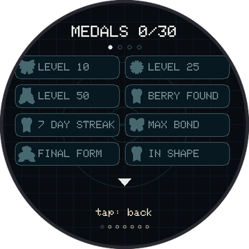</p>

## 8. Pokédex and hunting

Swipe **left** on the home screen. The Pokédex has 1025 Pokémon, 16 per page.

<p align="center">
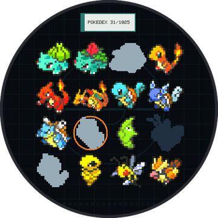
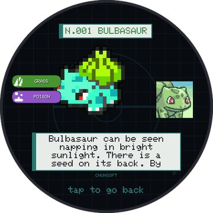
</p>

Each Pokémon shows up in one of three ways:

- **In colour**: registered (you have had it).
- **Grey-blue**: **seen**. You battled it, or it showed up on an adventure.
- **Dark**: never seen.

A registered Pokémon shows its sprite, cry, types and Pokédex text. The arrow
switches between normal, shiny, forms and Mega.

<p align="center">
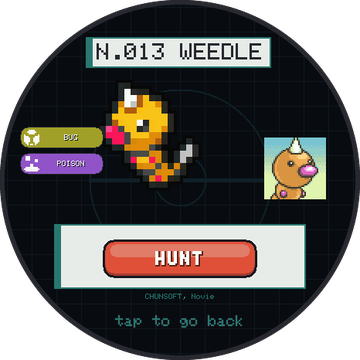
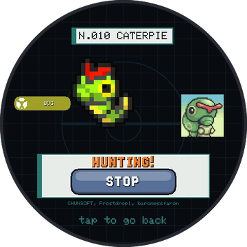
</p>

**Hunting.** Tapping a **seen** Pokémon shows it with a **HUNT** button. While you
hunt:

- **1 in 4** grass searches brings it, if it lives in that region;
- a legendary comes **1 in 10**, and only after the 8 badges;
- you hunt one species at a time: hunting another switches the hunt;
- the hunt ends when you catch the Pokémon;
- it only affects the grass, not the adventure;
- on the grid, the hunted Pokémon gets an orange ring.

A seen Pokémon that does not live in that region's grass shows "Not in the grass
here".

## 9. Adventure

The backpack button sends your main Pokémon out on a **trip**. The screen shows
the trip: it walks, plays, meets other Pokémon, fights, finds items and naps.
While it is away, the bars do not drop.

<p align="center">
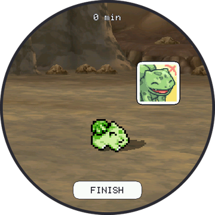
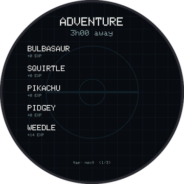
</p>

Tap **FINISH** to see the summary. The clock keeps counting even with the board
off:

- it counts up to **8 hours**, and after 2 hours time counts half;
- **EXP**: the main Pokémon gains about 1/4 of a level per hour, the rest of the
  team half of that, and up to 6 from the bank a quarter (always within the cap);
- **items**: one roll every 40 minutes (at most 8): medicine, held items, balls,
  stones and, rarely, a Mega Stone.

## 10. Professor's quiz

When the Professor appears on the home screen, tap him. There are 5 questions: a
Pokémon's type, what it evolves into, a move's type, the heaviest one, which move
it learns, and "Who's that Pokémon?".

<p align="center">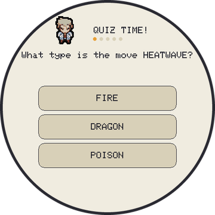</p>

**Prizes:**

| Right answers | Prize |
|---|---|
| 2 | Super Potion |
| 3 | Hyper Potion |
| 4 | Max Potion |
| 5 | 2 Rare Candy, or (1 in 20) the **Shiny Potion**, which makes your main Pokémon shiny |

## 11. Connecting two boards: trade and battle

On the card's **Team** page, tap **CONNECT**. The other board must be nearby with
the same screen open. Tap it and choose **TRADE** or **BATTLE**.

<p align="center">
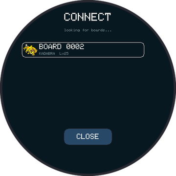
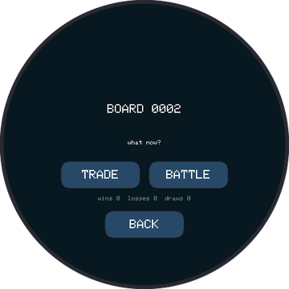
</p>

**Trade.** Each player picks a Pokémon from the team or the box, and both confirm.
- Its held item travels with it.
- Trade evolutions happen on arrival.
- Anyone arriving above the cap goes to the box.
- The newcomer is registered in your Pokédex.

<p align="center">
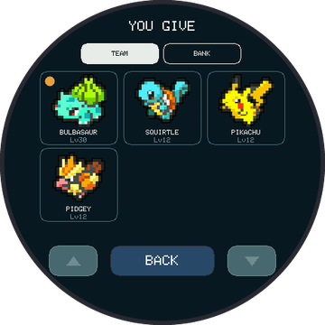
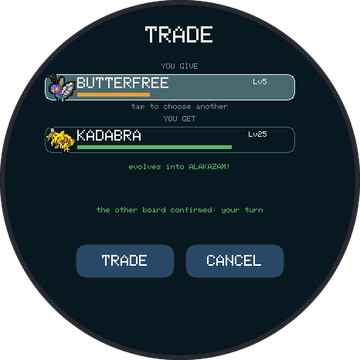
</p>

**Battle.** The player who invites sets the rules: 1v1, 3v3 or 6v6, and items
(none, up to 3, or free). Everyone fights at **level 50** and nobody disobeys.
Each choice has 60 seconds, and the flag gives up (tap it twice). **Your save
never changes**: only the win/loss/draw record does.

<p align="center">
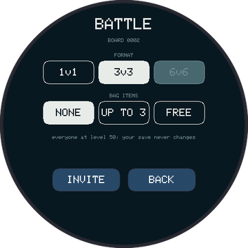
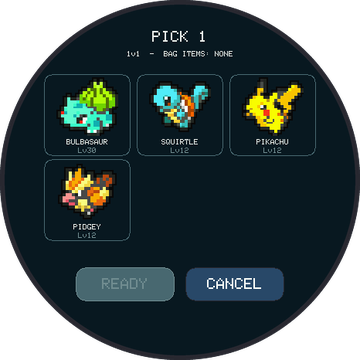
</p>

## 12. Evolution, farewell, running away and release

None of these happens on its own: the game always asks, and you watch.

<p align="center">
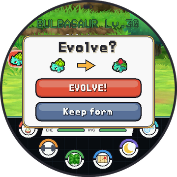
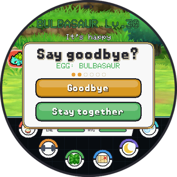
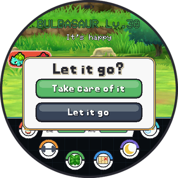
</p>

- **Evolution**: when it reaches the level, a red button appears. Choose
  **EVOLVE!** or **Keep form**. Stone evolutions use the stone from the bag. It
  does not evolve while holding an Everstone. Team members can evolve too: a green
  button appears.
- **Farewell**: in its final form, at least 3 days old, 1 day in that form and
  with bond 70 or more, it may say goodbye. It leaves an **egg** of the same
  species, with better genes, higher shiny odds and one of its moves. If you say
  no, it asks again the next day.
- **Running away**: with all 4 bars at zero for 1 hour, it runs away. Before that
  it cries every 15 minutes, and a single care action cancels it. One that runs
  away leaves the next egg weaker.
- **Release**: hold the Pokémon for 3 s.

<p align="center">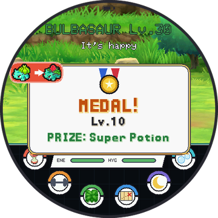</p>

## 13. Settings and power

Swipe **down** on the home screen. There you set the hour and minutes, the volume
(0 to 3), the **language** (ES, EN, FR, DE, IT, PT, JA, KO) and **ERASE ALL**
(which asks twice). Tap **OK** to apply, or swipe to cancel.

At the top is the **MANUAL** button: it shows a QR code. Point your phone camera
at it to open this manual (the Portuguese LEIAME when the game is in Portuguese,
this English README otherwise). Any tap closes the QR and returns to Settings.

<p align="center">
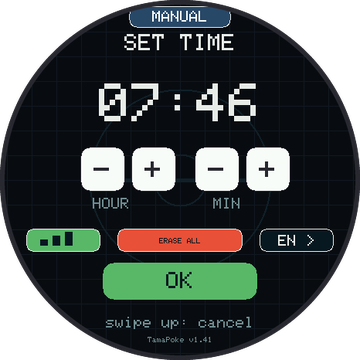
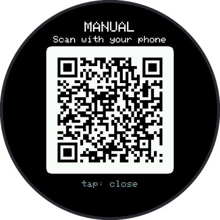
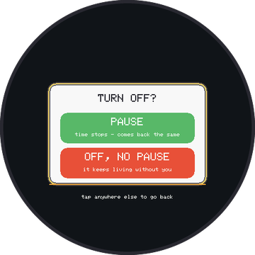
</p>

**The power button:**

- **Short press**: turns the screen off or on.
- **Hold**: asks how to turn off.
  - **PAUSE**: time stops, and it comes back exactly the same.
  - **OFF, NO PAUSE**: the clock keeps running, and it keeps living (and getting
    hungry) without you.

The screen dims on its own: after 90 seconds idle, and again after 5 minutes.

---

## 14. Bugs and suggestions

Found a bug or have an idea? Tell us through one of these:

- **GitHub:** open an *issue* at <https://github.com/foulusama37/TamaPoke/issues>.
- **Discord:** the **#sugestões-e-bugs-suggestions** channel on the Foulu Games
  server, <https://discord.gg/ueU3a4pSXz>. Building and flashing questions go to **#tamapoke-ajuda-help**.

To help us find it fast, include:

1. the firmware **version** (Settings: swipe down on the home screen);
2. **what you did** before it went wrong, step by step;
3. **what happened** and **what you expected**;
4. a **photo or video of the screen**, if you can.

Fixes ship in a new Release; nobody needs access to your board or save.

## 15. For developers

**Retaking the photos in this manual** after changing the game (from `test/`, with
the toolchain on PATH):

```sh
mingw32-make uibin
TAMA_MANUAL=pt ./build/tamapoke_uitests manual
TAMA_MANUAL=en ./build/tamapoke_uitests manual
cd .. && python tools/manual_fotos.py
```

The `manual` test is at the end of `test/test_ui.cpp`. It builds a sample game and
saves each screen to `_claude_scratch/prev_man_<language>_<screen>.ppm`.
`tools/manual_fotos.py` crops the photos into circles and puts them in
`docs/manual/img/`.

**Publishing a version** (the card goes in the Release, not in git):

```sh
python tools/pack_sdcard_zip.py      # -> dist/TamaPoke-sdcard-vX.YY.zip (verified)
```

Then attach the zip and both `.bin` files (`build/.../TamaPoke.ino.merged.bin` as
`instalacao-completa`, `TamaPoke.ino.bin` as `atualizacao`) to a new Release.
